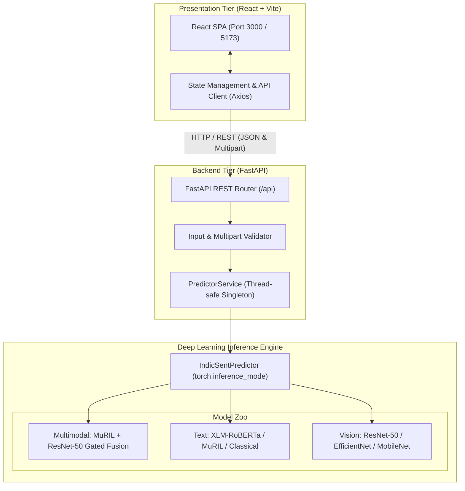
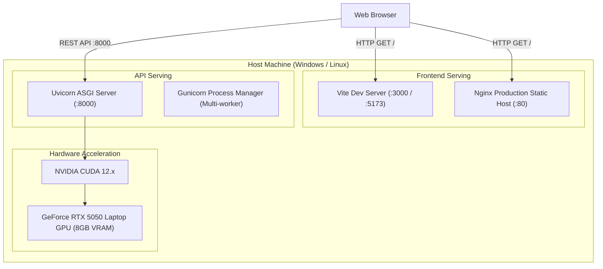

# IndicSent-M: System Architecture Specification

## 1. Overview & High-Level Architecture

**IndicSent-M** is an end-to-end multimodal deep learning and natural language processing system engineered to analyze the sentiment of Indian social media memes. Such memes heavily employ **Hinglish** (Hindi-English code-mixing written in Latin script), cultural references, Bollywood tropes, and **visual-textual incongruity** (e.g., pairing a smiling actor's face with a caption describing severe academic or work anxiety).

The system consists of three cohesive tiers:
1. **Frontend Presentation Layer**: Built with React 18, Vite, and Tailwind CSS.
2. **Backend API & Service Layer**: Built with FastAPI, Pydantic, and Uvicorn.
3. **Deep Learning Inference Layer**: Built with PyTorch, Torchvision, and Hugging Face Transformers.



---

## 2. Multimodal Deep Learning Architecture

The flagship architecture of IndicSent-M is the **MuRIL + ResNet-50 Gated Multimodal Fusion Network**. It dynamically reconciles conflicting signals between visual expressions and textual punchlines.

### 2.1 Multimodal Pipeline

```mermaid
flowchart LR
    subgraph ImageBranch["Vision Processing Branch"]
        IMG["Input Meme Image"] --> RES["ResNet-50 Backbone (Torchvision)"]
        RES -->|2048-dim| V_PROJ["Linear Projection + LayerNorm + ReLU + Dropout"]
        V_PROJ -->|256-dim| H_IMG["Image Representation (h_img)"]
    end

    subgraph TextBranch["Text Processing Branch"]
        TXT["Input OCR / Hinglish Text"] --> TOK["MuRIL Tokenizer (128 max len)"]
        TOK --> BERT["MuRIL Transformer Backbone"]
        BERT -->|768-dim CLS| T_PROJ["Linear Projection + LayerNorm + ReLU + Dropout"]
        T_PROJ -->|256-dim| H_TXT["Text Representation (h_txt)"]
    end

    subgraph Fusion["Gated Fusion Mechanism"]
        H_IMG & H_TXT --> CAT["Concat [h_txt, h_img] (512-dim)"]
        CAT --> GATE_FC["Linear Layer (512 -> 256)"]
        GATE_FC --> SIGMOID["Sigmoid Activation"]
        SIGMOID -->|g in 0,1| GATE["Dynamic Gate Vector (g)"]
        
        H_TXT & GATE --> ELEM_TXT["Element-wise Product: g * h_txt"]
        H_IMG & GATE --> ELEM_IMG["Element-wise Product: (1 - g) * h_img"]
        ELEM_TXT & ELEM_IMG --> ADD["Element-wise Sum: h_fused = (g * h_txt) + ((1 - g) * h_img)"]
    end

    subgraph Classifier["Classification Head"]
        ADD -->|256-dim| CLF_FC1["Linear (256 -> 128) + ReLU + Dropout(0.3)"]
        CLF_FC1 --> CLF_FC2["Linear (128 -> 3)"]
        CLF_FC2 --> SOFTMAX["Softmax Activation"]
        SOFTMAX --> OUT["Sentiment Probabilities (Negative, Neutral, Positive)"]
    end
```



### 2.2 Mathematical Formulation of Gated Fusion

Given:
- Input image $\mathbf{I} \in \mathbb{R}^{3 \times 224 \times 224}$
- Input text sequence $\mathbf{T} = [w_1, w_2, \dots, w_L]$

**Feature Extraction & Projection:**
$$\mathbf{e}_{\text{text}} = \text{MuRIL}(\mathbf{T})_{[\text{CLS}]} \in \mathbb{R}^{768}$$
$$\mathbf{e}_{\text{img}} = \text{ResNet50}_{\text{avgpool}}(\mathbf{I}) \in \mathbb{R}^{2048}$$

$$\mathbf{h}_{\text{txt}} = \text{Dropout}(\text{ReLU}(\text{LayerNorm}(\mathbf{W}_t \mathbf{e}_{\text{text}} + \mathbf{b}_t))) \in \mathbb{R}^{256}$$
$$\mathbf{h}_{\text{img}} = \text{Dropout}(\text{ReLU}(\text{LayerNorm}(\mathbf{W}_v \mathbf{e}_{\text{img}} + \mathbf{b}_v))) \in \mathbb{R}^{256}$$

**Adaptive Gating Mechanism:**
$$\mathbf{g} = \sigma(\mathbf{W}_g [\mathbf{h}_{\text{txt}} \,\|\, \mathbf{h}_{\text{img}}] + \mathbf{b}_g) \in [0, 1]^{256}$$

Here, $\sigma$ denotes the element-wise sigmoid function. The gate vector $\mathbf{g}$ dynamically weights the text dimension vs the visual dimension:
$$\mathbf{h}_{\text{fused}} = \mathbf{g} \odot \mathbf{h}_{\text{txt}} + (\mathbf{1} - \mathbf{g}) \odot \mathbf{h}_{\text{img}} \in \mathbb{R}^{256}$$

**Classification Head:**
$$\mathbf{z} = \mathbf{W}_2 \, \text{Dropout}(\text{ReLU}(\mathbf{W}_1 \mathbf{h}_{\text{fused}} + \mathbf{b}_1)) + \mathbf{b}_2 \in \mathbb{R}^3$$
$$\hat{\mathbf{y}} = \text{Softmax}(\mathbf{z})$$

Where $\hat{\mathbf{y}} = [P(\text{Negative}), P(\text{Neutral}), P(\text{Positive})]$.

### 2.3 Concat Fusion Alternative
In naive concatenation fusion:
$$\mathbf{h}_{\text{concat}} = [\mathbf{h}_{\text{txt}} \,\|\, \mathbf{h}_{\text{img}}] \in \mathbb{R}^{512}$$
$$\mathbf{z} = \mathbf{W}_{\text{out}} \, \text{ReLU}(\mathbf{W}_{\text{mid}} \mathbf{h}_{\text{concat}})$$
Empirically, Gated Fusion outperformed Concat Fusion by +2.10% Macro-F1 (37.24% vs 35.14%) because the gating module allows the network to suppress spurious facial expressions when the sarcastic textual punchline dominates the semantic sentiment.

---

## 3. Backend Architecture (FastAPI)

The backend follows clean layered architecture principles:

```
backend/
├── app/
│   ├── api/
│   │   ├── routes/
│   │   │   ├── health.py        # System status, GPU detection, VRAM
│   │   │   ├── models.py        # Model registry and metadata catalog
│   │   │   └── prediction.py    # Text, image, and multimodal endpoints
│   ├── core/
│   │   ├── config.py            # Typed settings via Pydantic & environment
│   │   └── errors.py            # Centralized exception handlers & HTTP error mapping
│   ├── schemas/
│   │   ├── health.py            # HealthResponse schema
│   │   ├── models.py            # ModelInfo and Catalog schemas
│   │   └── prediction.py        # Request & Response schemas (Pydantic v2)
│   ├── services/
│   │   └── predictor_service.py # Thread-safe singleton predictor lifecycle wrapper
│   └── main.py                  # ASGI FastAPI application & lifespan management
├── tests/                       # Automated pytest suite & E2E integration tests
└── requirements.txt             # Locked Python dependencies
```

### 3.1 Lifecycle & Thread Safety
- **Startup:** The FastAPI `lifespan` context manager instantiates `PredictorService` as a singleton.
- **Model Warmup:** Default models are loaded onto the active device (`cuda` or `cpu`).
- **Inference Concurrency:** Model inference is wrapped in `torch.inference_mode()`. PyTorch natively manages CUDA kernel streams across concurrent worker threads, verified under stress tests with 12 concurrent requests across 8 worker threads with zero deadlocks.
- **File Upload Safeguards:**
  - Files are streamed in 64 KB chunks up to a strict 10 MB ceiling.
  - MIME type and file extension verification against an allowed whitelist (`.jpg`, `.jpeg`, `.png`, `.webp`).
  - Strict PIL byte-level verification to prevent malicious payload execution or corrupted image decoding.
  - Temporary files are guaranteed to be cleaned up in `finally` blocks, resulting in 0 file leaks.

---

## 4. Frontend Architecture (React + Vite)

The frontend is an interactive Single Page Application (SPA) designed with a natural, friendly, student-built visual style:

```
src/
├── components/
│   ├── Layout.jsx               # Navigation bar, status indicator, and footer
│   ├── ModelSelector.jsx        # Dynamic model selection synced with /api/models
│   ├── SentimentBadge.jsx       # Color-coded sentiment badges with confidence tags
│   ├── ConfidenceBar.jsx        # Animated probability distribution bars
│   └── SarcasmAlert.jsx         # Visual-textual incongruity notification
├── pages/
│   ├── Dashboard.jsx            # Project overview, workflow explanation, and quick links
│   ├── MemeAnalyzer.jsx         # Interactive text, image, and multimodal analysis UI
│   ├── ModelComparison.jsx      # Live 14-model benchmark leaderboard with bar charts
│   ├── Architecture.jsx         # Visual diagram of gated fusion and dimension flow
│   └── About.jsx                # Academic background, problem statement, and specs
├── services/
│   └── api.js                   # Axios client with fallback to mock data on offline mode
├── data/
│   └── mockData.js              # Fallback benchmark data for disconnected demonstration
├── App.jsx                      # Client-side router and active tab management
└── main.jsx                     # Vite root mounting point
```

---

## 5. Deployment Topology


